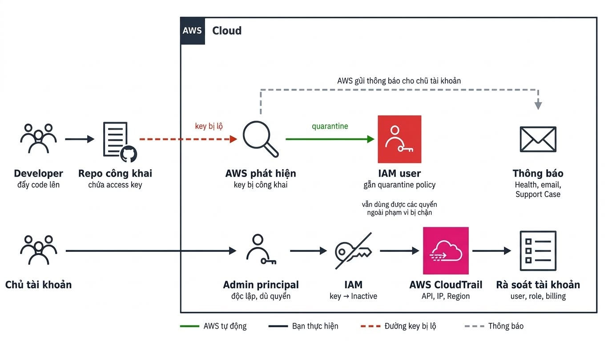

---

title: "Blog 3"
date: 2026-11-23
weight: 2
chapter: false
pre: " <b> 3.3. </b>  "
---

# AWS ACCESS KEY LEAKED ON GITHUB: AWS AUTOMATICALLY QUARANTINED IT, SO WHAT ELSE DO WE NEED TO DO?

When I first read about AWS Access Key exposure incidents, I assumed AWS already had automatic detection and handling, so the risk wasn't too worrying. After looking into it more closely, I realized that was only partly true: AWS can help detect and limit the damage, but that doesn't mean our account is safe. This post explains what AWS actually does when a key is exposed, the steps we still need to take, and how to prevent it.

Key points to remember:

* AWS can detect credentials that are publicly exposed on sources such as GitHub. When it does, it may apply a quarantine policy (**AWSCompromisedKeyQuarantineV3** or **V4**) to the related IAM identity and send a notification through AWS Health or a Support Case.
* In one Unit 42 experiment, AWS attached the V3 policy about 10 seconds after the key was made public. This is the result of a specific test, not a guaranteed response time in every case.
* A quarantine policy does **not** disable the access key. It only adds Deny permissions for certain specific actions, while other actions still depend on the identity's other IAM permissions.
* **Step 1 – Isolate the credential:** identify the IAM user that owns the key, assess its permission scope, and set the key to Inactive. Avoid deleting it right away so it remains available for cross-checking.
* **Step 2 – Restore legitimate access:** identify the workloads using the old key, update them with valid credentials, and consider moving to IAM Roles that use temporary credentials.
* **Step 3 – Investigate with CloudTrail:** review which APIs were called, when, from which IP, in which Region, and any unusual IAM changes. Use a separate admin principal to investigate. Event History mainly contains management events, while data events (such as S3 object access) must have been configured for logging beforehand.
* **Step 4 – Check for signs of compromise across the whole account:** new or unexpectedly changed IAM users/roles/policies, unfamiliar EC2/Lambda resources, unauthorized S3 access, rarely used Regions, and abnormal Billing charges.
* **Step 5 – Complete remediation:** don't remove the quarantine policy just because the application works again; follow the guidance in the AWS Support Case.
* **Prevention:** use IAM Roles for workloads, IAM Identity Center/Federation for users, GitHub Actions OIDC instead of long-term access keys, enable GitHub Secret Scanning \& Push Protection, and use pre-commit hooks such as git-secrets.
* Removing a secret from a file or commit does **not** make the credential safe. Once exposed publicly, treat it as possibly copied and follow the incident response process.

My takeaway: no automatic mechanism can replace proper management of identities, permissions, and credentials. In the Cloud, security isn't only about preventing unauthorized access, but also knowing how to detect, investigate, isolate, and recover when an incident happens.

How do you manage AWS credentials for personal or team projects? Especially with GitHub Actions, do you use OIDC or still store access keys in GitHub Secrets? I'd love to hear real-world experience.

https://www.facebook.com/share/p/1EAiomrDcV/

