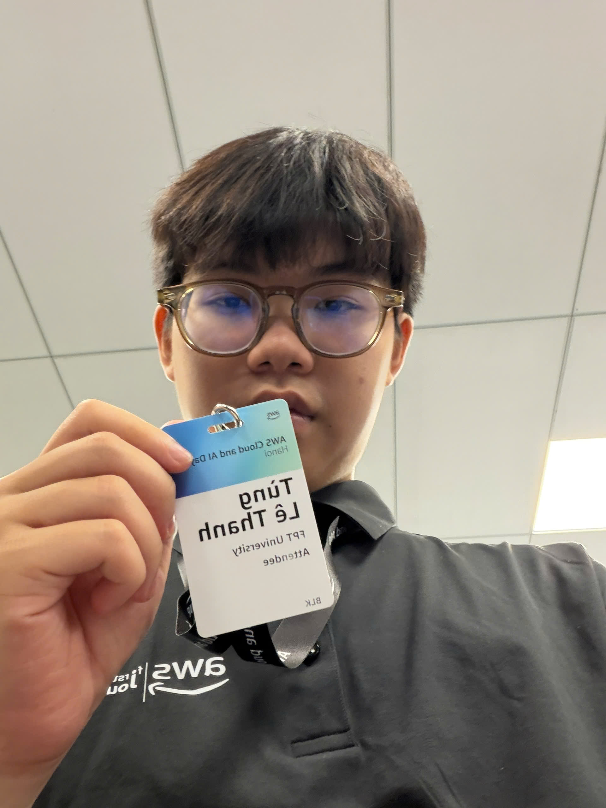

---

title: "Event 2"
date: 2026-09-29
weight: 2
chapter: false
pre: " <b> 4.2. </b>  "
---

# Event Report: “AWS Cloud \& AI Day Hanoi 2026”

### General Information

* **Event:** AWS Cloud \& AI Day Hanoi 2026
* **Time:** 09:00 – 17:00, September 29, 2026
* **Location:** 26th Floor, Bitexco Financial Tower, 2 Hai Trieu Street, Ho Chi Minh City
* **Role:** Participant

### Why I Attended and What I Expected

* Understand why cloud, Generative AI, and Agentic AI are moving out of the lab and into real enterprise operations.
* Catch up on how to build cloud-native applications, infrastructure, data platforms, workload identity, and AI governance.
* See how Vietnamese enterprises and AWS modernize systems at scale.
* Learn how security, governance, observability, and human oversight must grow as AI becomes more autonomous.
* Connect the event's content to my own direction in cybersecurity and cloud security.

### Guests and Speakers

* **Dr. Werner Vogels** – CTO, Amazon.com, keynote speaker
* **Eric Yeo** – Country General Manager for Malaysia, Vietnam \& Indochina, AWS
* **Mai Le** – Director of Product Management, Katalon
* **Dr. Jens Lottner** – Chief Executive Officer, Techcombank
* Experts, architects, and technology leaders from AWS, Katalon, Techcombank, TCBS, Techcom Life, VPBank, and other organizations

### Key Highlights

#### &#x20;From Cloud-Native Architecture to Agentic AI

* The trend goes beyond “moving servers to the cloud” toward building flexible, highly automated systems based on containers, Kubernetes, serverless, event-driven architecture, and managed services.
* Platform Engineering and Internal Developer Platforms provide ready-made “Golden Paths”, so developers wait less on manual ticket approvals to get infrastructure.
* The tools mentioned include Amazon EKS, Crossplane, Terragrunt, Backstage, FluxCD, and GitOps, which make deployments consistent, repeatable, and easy to audit.

#### &#x20;Taking AI Agents from Prototype to Production

Building a working agent is easy; keeping it safe in operation is hard. Four pillars must be met:

* **Operational excellence:** reliability, error handling, latency, and continuous monitoring.
* **Data governance:** who owns the data, how fresh it is, its quality, and who can access it.
* **Security and trust:** control over identity, allowed tools, permissions, and sensitive information.
* **Human oversight:** actions with high impact or that cannot be undone must have a responsible person.

Sessions on Amazon Bedrock, Bedrock AgentCore, Strands Agents, Model Context Protocol (MCP), and the ReAct model showed how an agent reasons, looks up information, calls tools, retains context, and acts within a defined permission scope.

#### &#x20;Identity, Least Privilege, and AI Security

* Instead of only removing long-lived access keys, the new direction is to give workloads an identity that can be verified across multiple trust boundaries.
* Key mechanisms include AWS IAM, AWS STS (short-lived credentials), trust policies, session policies, session tags, source identity, and ABAC, applied to EC2, ECS/Fargate, Lambda, EKS, CI/CD, multi-account systems, and AI agents.

#### &#x20;AI Governance and Data Security

* Enterprise AI is not just about choosing a model; it is a data and governance problem: accuracy, freshness, provenance, ownership, access control, evidence behind answers, and decision traceability.
* The security chain is summarized as: **Identity → Data → Model → Tools → Agent → Action → Audit**.

#### &#x20;Security Observability for AI Applications

The traditional four golden signals (latency, errors, traffic, saturation) need to be extended with:

* **Cost:** token consumption and unusual spikes.
* **Safety:** personal data exposure, prompt injection, and tools used for the wrong purpose.
* **Quality:** hallucinations and inaccurate answers.

Monitoring data should be combined from infrastructure, security events, data access, and agent behavior.

#### &#x20;AI-Assisted Software Development, Done Securely

* Kiro and AI-DLC bring AI into the entire development lifecycle: planning, design, coding, testing, documentation, deployment, technical debt handling, and modernization. TCBS reported about a 26% reduction in development time.
* The conditions are verification, security review, governance, human approval, and DevSecOps integration.

#### &#x20;Cloud Modernization and Enterprise Security

* Cases from Techcombank, Techcom Life, TCBS, VPBank, and Katalon centered on application and database modernization, containerization, data platform consolidation, infrastructure automation, observability, compliance, and resilience.
* For data-residency requirements, AWS introduced the Local Zone in Hanoi and second-generation AWS Outposts. The common challenge is balancing security, compliance, reliability, performance, cost, and business agility.

### Lessons Learned

#### Security Mindset

* **Identity is a security boundary.** Every workload, pipeline, service, and AI agent should have its own identity with short-lived credentials and least-privilege access.
* **Protect the whole AI chain** from identity to audit, and let humans decide at high-risk steps.
* **Extend monitoring** to AI behavior, data access, safety, quality, and cost.

#### Architecture and Engineering

* Prefer reproducible and traceable infrastructure (managed services, containers, serverless, IaC, GitOps) over logging in via SSH to make manual fixes.
* Combine IAM, STS, ABAC, and multi-account access with trustworthy data sources.

#### AI and Cybersecurity

* Agents must be evaluated on whether they work with the right identity, permissions, data, and evidence, because AI opens new attack surfaces such as prompt injection, data leakage, excessive permissions, unauthorized actions, hallucination, and hard-to-control costs.
* Cloud Security, DevSecOps, AI Security, and Security Operations are increasingly intertwined.

### How I Plan to Apply This

* Practice least-privilege IAM with short-lived credentials: build a small lab with a role, trust policy, and session tags, then check the traces in the audit logs.
* Expand monitoring: collect infrastructure logs, identity events, application telemetry, and AI agent activity; explore bringing Wazuh and SIEM into cloud and AI security.
* Apply GitOps and IaC to infrastructure changes, and set boundaries for permissions, data, logging, and approvals when experimenting with AI agents.
* Use AI tools to speed up work while keeping security review and human approval, and connect network/endpoint security knowledge with cloud-native security.

### Personal Reflection

The event gave me a broad view of system modernization, agentic AI, and security at enterprise scale.

* Hearing AWS leaders and enterprises share showed me that technology always has to go hand in hand with governance, operations, security, and organizational change.
* Real-world examples tied cloud and AI knowledge to compliance requirements and true production scale.
* Automation without governance can raise risk as fast as it raises productivity. The more autonomous a system is, the tighter identity and permission control must be.
* Security professionals must not only detect attacks but also know how to protect, monitor, and govern AI systems themselves.

### Check-in Photos

