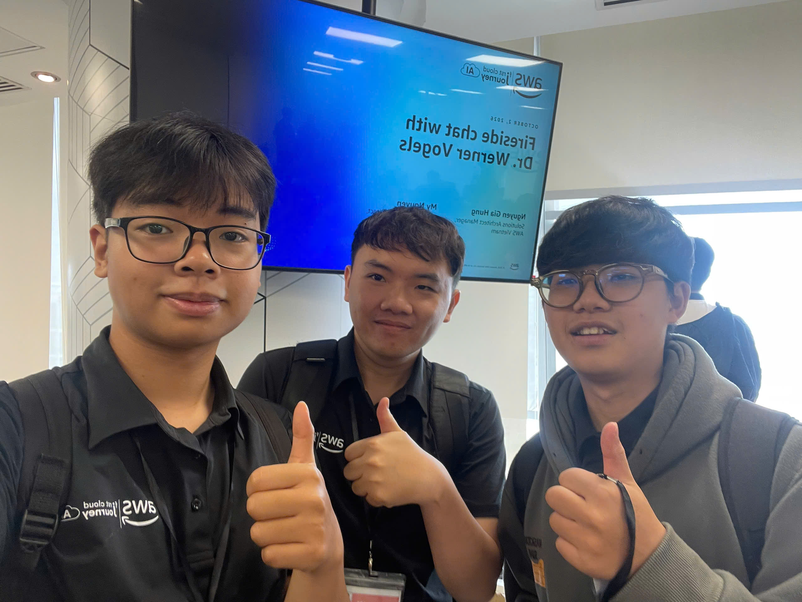

---

title: "Fireside Chat with Dr. Werner"
date: 2026-02-10
weight: 4
chapter: false
pre: " <b>4.4.</b>  "
---

# Event Summary Report: "Fireside Chat with Dr. Werner"

* **Event name:** Fireside Chat with Dr. Werner
* **Date \& time:** 08:30 – 12:00, Friday, October 2, 2026
* **Venue:** Bitexco Financial Tower, 2 Hai Trieu Street, Saigon, Ho Chi Minh City 700000, Vietnam
* **Role:** Attendee

### Goals for Attending

* Hear directly from Dr. Werner Vogels, CTO of Amazon, on his views about cloud computing, artificial intelligence, and the future of technology
* Learn from experience in building and operating systems at global scale
* Explore innovation, leadership mindset, and the technology trends shaping the next wave of digital transformation
* Join the interactive Q\&A and networking, and connect with students, developers, solutions architects, engineers, and other tech professionals

### Speaker

* **Dr. Werner Vogels** – Chief Technology Officer (CTO), Amazon.com

### Highlights

#### Perspectives from Amazon's CTO – Dr. Werner Vogels

* Heard firsthand from one of the most influential technology leaders and a pioneer of cloud computing
* Saw how the cloud foundation connects with emerging trends in artificial intelligence and digital transformation

#### Global-Scale Systems, Innovation \& Leadership

* Explored lessons learned from building and operating systems at global scale
* Gained a clearer understanding of innovation, the role of technology leadership, and how organizations adapt to the next generation of technology

#### Interactive Q\&A \& Community Networking

* Took part in the Q\&A session and talked directly about Cloud, AI, and the journey of working in tech
* Connected with a community of students, software engineers, developers, solutions architects, DevOps engineers, data engineers, and AI practitioners

### Key Takeaways

#### Systems \& Architecture at Scale

* **A mindset for building and operating at global scale**: Look at system problems more broadly than delivering a single feature, and pay attention to how a system runs and grows at scale
* **The link between Cloud and AI**: Place foundational cloud knowledge alongside the growth of AI and digital transformation to see the full picture

#### Leadership, Innovation \& Community

* **Learning from seasoned veterans**: Hearing real-world insights from a technology leader shows how to combine innovation with solid engineering
* **Exchanging diverse perspectives within the community**: Meeting people in many roles, from students to engineers and architects, broadens how you look at problems

### Applying to My Work

* **Prioritize scale, stability, and operability**: Bring an operations and scalability mindset into studying, doing labs, and building systems on the cloud
* **Connect Cloud knowledge with AI trends**: Observe how cloud and AI complement each other instead of studying each area in isolation
* **Actively join discussions and build connections**: Make the most of Q\&A sessions and networking to learn practical experience from others in the field

### Event Experience

Attending **"Fireside Chat with Dr. Werner"** at Bitexco Financial Tower was a memorable opportunity to hear Amazon's CTO, Dr. Werner Vogels, speak directly with the tech community. Key aspects of the experience include:

#### Learning from a Cloud Pioneer

* Dr. Werner Vogels' talks on cloud computing, AI, innovation, leadership, and global-scale systems made the concepts behind large systems clearer and more inspiring.
* The conversation offered practical perspectives on how technology trends affect system architecture and digital transformation.

#### Diverse Perspectives from the Community

* The presence of students, developers, solutions architects, DevOps/data engineers, and AI practitioners created an open and energetic atmosphere.
* The interactive Q\&A helped link big ideas with the real questions of people working in engineering.

#### Lessons Learned

* Building and operating systems at large scale requires a unified view of architecture, innovation, and how organizations are run and led.
* Actively listening, asking questions during Q\&A, and connecting with the community turns inspiring talks into concrete lessons for yourself.

#### Event Photos

> Overall, the fireside chat offered deep insights from Dr. Werner Vogels on global-scale systems, Cloud, AI, and innovation, and also helped me connect further with the tech community.

