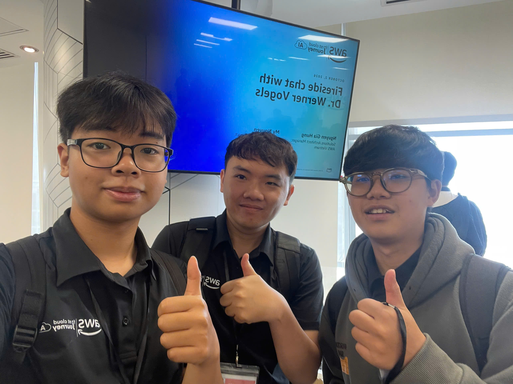

---

title: "Fireside Chat with Dr. Werner"
date: 2026-2-10
weight: 4
chapter: false
pre: " <b>4.4.</b>  "
---

# Báo cáo tổng kết: “Fireside Chat with Dr. Werner”

* **Tên sự kiện:** Fireside Chat with Dr. Werner
* **Thời gian:** 08:30 – 12:00, Thứ Sáu, 02/10/2026
* **Địa điểm:** Tòa nhà Bitexco Financial Tower, số 2 Hải Triều, Sài Gòn, TP. Hồ Chí Minh 700000, Việt Nam
* **Vai trò:** Khách tham dự

### Mục đích tham gia

* Nghe trực tiếp quan điểm của Dr. Werner Vogels, CTO của Amazon, về điện toán đám mây, trí tuệ nhân tạo và định hướng phát triển công nghệ trong tương lai
* Rút kinh nghiệm từ cách xây dựng và vận hành những hệ thống có quy mô toàn cầu
* Tìm hiểu về sáng tạo đổi mới, phong cách lãnh đạo và các xu hướng công nghệ sẽ dẫn dắt làn sóng chuyển đổi số kế tiếp
* Tham gia phần hỏi đáp và giao lưu, làm quen với sinh viên, lập trình viên, kiến trúc sư giải pháp, kỹ sư cùng những người làm trong ngành công nghệ

### Khách mời chia sẻ

* **Dr. Werner Vogels** – Giám đốc Công nghệ (CTO), Amazon.com

### Những nội dung đáng chú ý

#### Quan điểm của CTO Amazon – Dr. Werner Vogels

* Được nghe chia sẻ trực tiếp từ một trong những nhà lãnh đạo công nghệ có sức ảnh hưởng lớn, đồng thời là người đi đầu trong lĩnh vực điện toán đám mây
* Thấy được sự kết nối giữa nền tảng cloud với các xu hướng mới như trí tuệ nhân tạo và chuyển đổi số

#### Hệ thống toàn cầu, Sáng tạo \& Lãnh đạo

* Tìm hiểu những bài học rút ra từ quá trình xây dựng và vận hành hệ thống ở tầm vóc toàn cầu
* Hiểu rõ hơn về sáng tạo đổi mới, vai trò của người dẫn dắt về công nghệ và cách các tổ chức thích nghi với thế hệ công nghệ sắp tới

#### Hỏi đáp trực tiếp \& Giao lưu cộng đồng

* Tham gia phần Q\&A và trò chuyện trực tiếp về Cloud, AI cũng như con đường theo đuổi nghề công nghệ
* Kết nối với cộng đồng gồm sinh viên, software engineer, developer, solution architect, DevOps engineer, data engineer và AI practitioner

### Những bài học quan trọng

#### Hệ thống \& Kiến trúc ở quy mô lớn

* **Cách nghĩ khi xây dựng và vận hành ở tầm toàn cầu**: Nhìn bài toán hệ thống rộng hơn việc hoàn thiện một tính năng riêng lẻ, quan tâm đến việc hệ thống chạy và lớn lên như thế nào ở quy mô lớn
* **Sự gắn kết giữa Cloud và AI**: Đặt kiến thức nền về cloud song song với sự phát triển của AI và chuyển đổi số để có cái nhìn toàn diện

#### Lãnh đạo, Sáng tạo \& Cộng đồng

* **Học hỏi từ những người đi trước nhiều kinh nghiệm**: Nghe chia sẻ thực tế từ lãnh đạo công nghệ giúp hiểu cách kết hợp tinh thần sáng tạo với nền tảng kỹ thuật chắc chắn
* **Trao đổi nhiều góc nhìn trong cộng đồng**: Gặp gỡ đủ vai trò, từ sinh viên đến kỹ sư, kiến trúc sư, giúp mở rộng cách nhìn nhận vấn đề

### Vận dụng vào công việc

* **Coi trọng quy mô, độ ổn định và khả năng vận hành**: Đưa tư duy về vận hành và mở rộng vào việc học, thực hành lab và xây dựng hệ thống trên cloud
* **Liên kết kiến thức Cloud với xu hướng AI**: Quan sát cách hai mảng này hỗ trợ lẫn nhau, thay vì học riêng rẽ từng phần
* **Chủ động thảo luận và mở rộng kết nối**: Tận dụng các phiên Q\&A và hoạt động giao lưu để học thêm kinh nghiệm thực tế từ những người cùng ngành

### Cảm nhận về sự kiện

Được tham dự buổi **“Fireside Chat with Dr. Werner”** tại Bitexco Financial Tower là một trải nghiệm đáng nhớ, khi trực tiếp nghe CTO của Amazon, Dr. Werner Vogels, trò chuyện cùng cộng đồng người làm công nghệ. Một số điểm nhấn của trải nghiệm này:

#### Học từ người đi đầu trong lĩnh vực Cloud

* Những chia sẻ của Dr. Werner Vogels về điện toán đám mây, AI, sáng tạo đổi mới, lãnh đạo và hệ thống toàn cầu giúp các khái niệm về hệ thống lớn trở nên dễ hình dung và đầy cảm hứng.
* Buổi trò chuyện đem lại nhiều góc nhìn thực tiễn về việc các xu hướng công nghệ ảnh hưởng thế nào đến kiến trúc hệ thống và chuyển đổi số.

#### Nhiều góc nhìn từ cộng đồng

* Sự có mặt của sinh viên, lập trình viên, kiến trúc sư giải pháp, kỹ sư DevOps/dữ liệu và người làm AI tạo nên không khí trao đổi thoải mái, tràn đầy năng lượng.
* Phần hỏi đáp tương tác giúp nối những ý tưởng lớn với các câu hỏi thiết thực của người làm kỹ thuật.

#### Điều rút ra

* Để xây dựng và vận hành hệ thống ở quy mô lớn, cần nhìn tổng thể cả kiến trúc, sáng tạo đổi mới lẫn cách tổ chức và lãnh đạo.
* Chủ động lắng nghe, đặt câu hỏi trong phần Q\&A và kết nối với cộng đồng giúp biến những buổi chia sẻ mang tính định hướng thành bài học cụ thể cho bản thân.

#### Hình ảnh từ sự kiện

> Tóm lại, buổi fireside chat đã mang đến những góc nhìn sâu sắc từ Dr. Werner Vogels về hệ thống toàn cầu, Cloud, AI và sáng tạo đổi mới, đồng thời giúp mình mở rộng kết nối với cộng đồng công nghệ.

